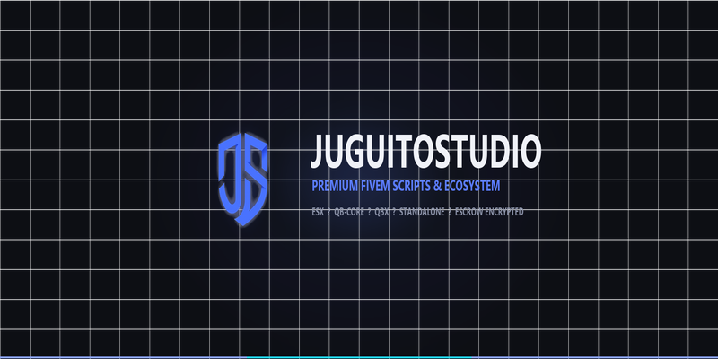

# 🧃 JuguitoStudio — Documentación Oficial

Bienvenido al centro de documentación oficial de **JuguitoStudio**. Aquí encontrarás todas las guías de instalación, referencia de configuración, adaptadores de integraciones y resolución de problemas para todos nuestros recursos de FiveM.

---

  

---

## 🚀 Nuestros Estándares de Desarrollo

Todos los scripts de JuguitoStudio han sido construidos bajo estrictos principios de calidad:

- **⚡ Cero Lag & Alta Optimización:** Hilos adaptativos, caching inteligente y liberación total de memoria al cerrar interfaces.
- **🔧 Arquitectura Multi-Framework:** Compatibilidad nativa e inmediata con **ESX**, **QB-Core**, **QBX** y servidores **Standalone**.
- **🔓 Código Abierto en Integraciones:** La carpeta `integrations/` de cada recurso es 100% de código abierto (en `escrow_ignore`) para conectar tus sistemas propios sin tocar el código protegido.
- **🎨 Sistema de Diseño Unificado:** Todas las interfaces NUI comparten la misma paleta visual moderna con modo oscuro, tipografías nítidas y efectos de cristal (*glassmorphism*).
- **🌐 Sistema Multiidioma:** Localizaciones en español e inglés incluidas por defecto, fáciles de extender a cualquier idioma.

---

## 📦 Catálogo de Scripts

| Script | Versión | Tipo | Estado |
|---|---|---|---|
| [**js_loadingscreen**](scripts/js_loadingscreen/README.md) | `v1.0.0` | Loading Screen / NUI | Lanzado |

---

## 💬 Soporte & Comunidad

Si necesitas asistencia con cualquiera de tus compras o deseas sugerir nuevas características:

- 🎮 **Discord Oficial:** [discord.gg/juguito](https://discord.gg/juguito)
- 🛒 **Tienda Tebex:** [juguito.tebex.io](https://juguito.tebex.io)
